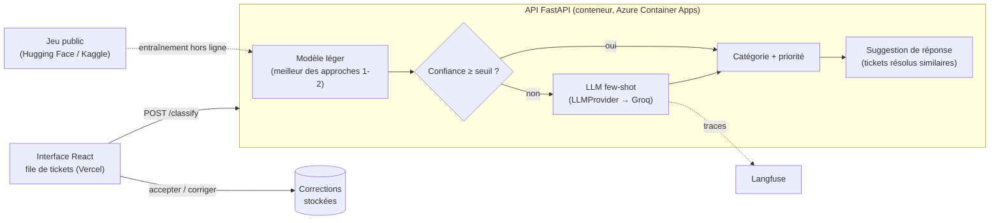

# SPEC — Routage automatique des tickets de support

## Problème et coût
Sur un service desk (infogérance, TMA, DSI interne), chaque ticket entrant doit être affecté à la bonne file (réseau, accès, facturation, matériel…) avec la bonne priorité. Ce triage est souvent manuel. Quand il se trompe, le ticket est réaffecté d'équipe en équipe, le délai de résolution s'allonge, des SLA sont ratés (avec des pénalités contractuelles en infogérance) et du temps d'ingénieur est perdu à lire des tickets qui ne sont pas les siens.

Un LLM sait souvent bien classer, mais l'appeler sur chaque ticket coûte cher et ajoute de la latence. La question du projet : **quelle qualité de routage obtient-on, à quel coût, et combien d'appels au LLM peut-on éviter sans perdre en qualité ?**

## Utilisateurs
- **Agent de niveau 1 / dispatcher** : voit la file des tickets entrants avec la catégorie et la priorité proposées, accepte ou corrige en un clic.
- **Responsable du service desk** : suit la qualité du routage et le coût (part de tickets traités sans LLM, corrections humaines).
- **Équipe technique** : intègre l'API de classification à son outil de ticketing.

## Périmètre
1. **Jeu de données** public de tickets de support multilingue, avec catégorie (ou file) et priorité ; on garde le français et l'anglais. Découpage train / validation / test figé et versionné (identifiants seulement).
2. **Trois approches** évaluées sur le même jeu de test :
   - TF-IDF + régression logistique (base de référence) ;
   - embeddings multilingues + classifieur ;
   - LLM en few-shot, derrière l'interface `LLMProvider` (Groq, offre gratuite).
3. **Routage hybride retenu** : modèle léger d'abord, appel au LLM seulement quand la confiance est sous un seuil choisi sur la validation.
4. **Suggestion de réponse** par RAG sur les tickets résolus similaires du jeu d'entraînement.
5. **API de classification** (FastAPI) : catégorie, priorité, confiance, approche utilisée, suggestion de réponse.
6. **Interface de file de tickets** (React) avec validation humaine : accepter ou corriger ; les corrections sont stockées.
7. **Traces Langfuse** des appels au LLM, et protection de la démo publique (limite par IP, quota quotidien).

## Hors périmètre
Kubernetes et ArgoCD (démontrés en P4), authentification, intégration réelle à ServiceNow ou Jira, réentraînement automatique à partir des corrections (les corrections sont stockées pour une suite possible).

## Architecture

## Données
Choix au ticket **P2-01**, justifié ici. Critères, dans l'ordre :
1. jeu public avec licence qui autorise l'usage, téléchargeable par script ;
2. tickets en français et en anglais (on écarte les autres langues) ; à défaut, de vraies données multilingues ;
3. une étiquette de catégorie ou de file **et** une étiquette de priorité ;
4. assez d'exemples par classe pour un jeu de test qui donne des intervalles de confiance exploitables, et une réponse ou résolution par ticket pour la suggestion de réponse ;
5. on documente les limites : données synthétiques ou réelles, déséquilibre des classes, qualité des étiquettes.

Les données brutes ne sont pas versionnées (`data/raw/`). Le dépôt versionne le script de téléchargement, la révision exacte du jeu et les identifiants du découpage.

### Jeu retenu (P2-01, 01/11/2026)
**Tobi-Bueck/customer-support-tickets** (Hugging Face), fichier `aa_dataset-tickets-multi-lang-5-2-50-version.csv`, révision `ddf1c81a5475992c4fa6752bf1e8b4e31f07bbeb`, vérifié par SHA-256 (`scripts/download_data.py`).
- **Pourquoi** : c'est le seul jeu public trouvé qui réunit file (10 valeurs), priorité (3 valeurs : low, medium, high), type, réponse de l'agent et langue, avec assez d'exemples (28 587 tickets). Autre candidat examiné : tasksource/it-support-tickets (2 229 tickets, une seule étiquette, ni priorité ni réponse).
- **Écart avec le cadrage** : le jeu ne contient **pas de français**, seulement l'anglais (57,1 %) et l'allemand (42,9 %), et aucune révision antérieure n'en contenait. Décision de Francis (01/11/2026) : garder l'anglais et l'allemand, de vrais tickets multilingues, plutôt qu'un test français traduit automatiquement. La fiche du jeu mentionne une autre version, sur Kaggle, avec du français : c'est une piste de suite.
- **Licence** : CC BY-NC 4.0 (usage non commercial : compatible avec un projet de portfolio, à revoir pour un usage en entreprise).
- **Nature** : la fiche met en avant le générateur de tickets synthétiques de l'auteur et annonce l'absence de données personnelles. On traite donc ces tickets comme **probablement synthétiques** : les scores obtenus ne garantissent pas les mêmes résultats sur de vrais tickets, plus bruités. C'est la première limite du projet.
- **Qualité** : aucun corps vide, 15 doublons (corps identiques à la casse et aux espaces près) retirés avant le découpage, 3 838 sujets vides (le texte d'un ticket est le sujet suivi du corps), 7 réponses vides.
- **Découpage** : stratifié par (langue, file), graine 2026, 70 / 15 / 15 → entraînement 19 998, validation 4 287, test 4 287 tickets. Identifiants versionnés dans `data/splits/`, statistiques complètes dans [docs/donnees.md](docs/donnees.md).
- **Déséquilibre** : la file la plus fréquente (Technical Support) représente 29,3 % des tickets, la plus rare (General Inquiry) 1,4 %. D'où le choix du F1 macro, qui donne le même poids à chaque file.

## Protocole d'évaluation
- **Découpage** stratifié par catégorie, graine fixe : entraînement / validation / test. Tous les réglages (hyperparamètres, exemples few-shot, seuil de confiance du routage hybride) se décident sur la validation ; le test ne sert qu'à la mesure finale.
- **Métriques** :
  - F1 macro de la catégorie et de la priorité, avec intervalle de confiance à 95 % (bootstrap) ;
  - matrices de confusion ;
  - latence p50 / p95 par ticket ;
  - coût pour 1 000 tickets (tarif public du fournisseur LLM ; calcul CPU négligé et indiqué comme tel) ;
  - part des tickets traités sans LLM (routage hybride).
- **Tableau comparatif** : les trois approches et le routage hybride, sur le même jeu de test.
- **LLM** : l'offre gratuite limite le débit (P1 a montré qu'une évaluation complète peut épuiser le quota du jour). L'évaluation du LLM porte donc sur un échantillon de test fixé et documenté, et l'on ne lance jamais deux évaluations LLM en même temps.
- **CI** : un sous-ensemble bloque la fusion sous des seuils fixés à l'avance ; l'évaluation complète tourne à chaque tag de version.

## Definition of Done
1. Dépôt GitHub public, README « étude de cas » : Problème (et son coût) → Approche → Architecture (Mermaid) → Résultats mesurés (tableau) → Démo (GIF + URL) → Lancer en local (3 commandes) → Limites et suite.
2. Tests et CI verts ; l'évaluation tourne en CI sur un sous-ensemble et bloque sous le seuil ; l'évaluation complète tourne à chaque tag.
3. API déployée via Terraform (Azure Container Apps ; Terraform Cloud Run prêt), front sur Vercel, URL publique fonctionnelle.
4. `docs/evaluation.md` : protocole, jeu de test, résultats, comparaison avec la base de référence.
5. `docs/explications/` : une fiche par ticket ; Francis répond sans aide aux 5 questions de chaque fiche.
6. `JOURNAL.md` : entrée « LIVRÉ » avec les 3 chiffres clés et l'URL de démo.

## Calendrier
Prévu du 26/10 au 13/11/2026 ; démarré le 01/11/2026, après la livraison de P1. Fin visée : 13/11/2026.
