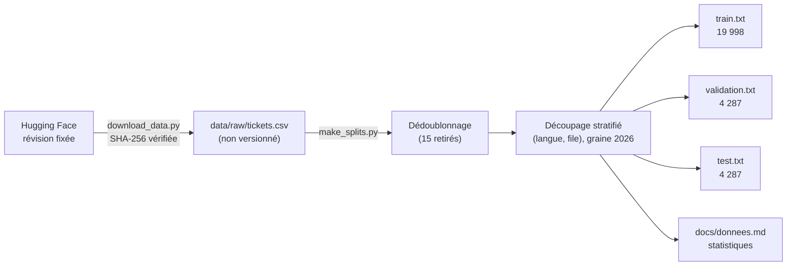

# P2-01 — Choix et préparation du jeu de données

## Ce qui a été fait
- **Recherche d'un jeu public** sur Hugging Face, avec quatre critères : file, priorité, réponse de l'agent, langue. Retenu : **Tobi-Bueck/customer-support-tickets**, 28 587 tickets, 10 files, 3 priorités, sous licence CC BY-NC 4.0.
- **Écart avec le cadrage** : le cadrage demandait du français et de l'anglais, mais aucun jeu vérifié ne réunit français, file et priorité. Celui-ci contient de l'anglais (57,1 %) et de l'allemand (42,9 %). Francis a choisi de garder ces deux langues réelles plutôt qu'un test français traduit automatiquement.
- **Téléchargement reproductible** (`scripts/download_data.py`) : révision du dépôt Hugging Face fixée, empreinte SHA-256 vérifiée, fichier rangé dans `data/raw/`, qui n'est pas versionné.
- **Dédoublonnage** : 15 tickets dont le corps est identique à un autre, à la casse et aux espaces près, sont retirés avant le découpage.
- **Découpage stratifié** par (langue, file), graine 2026, 70 / 15 / 15 : 19 998 tickets d'entraînement, 4 287 de validation, 4 287 de test. Seuls les identifiants sont versionnés (`data/splits/`).
- **Statistiques publiées** dans `docs/donnees.md`, générées par `scripts/make_splits.py` : répartition par file, priorité, langue et type pour chaque partie.

## Pourquoi ce choix plutôt que l'alternative courante
- **Une révision et une empreinte fixées plutôt que « la dernière version »** : un jeu public peut changer (P1 l'a vécu avec un document déplacé). Avec la révision et l'empreinte, chaque mesure du projet porte sur exactement les mêmes tickets, et un changement est détecté au lieu de passer inaperçu.
- **Versionner les identifiants du découpage plutôt qu'un `train_test_split` refait à chaque fois** : les trois approches et le routage hybride seront comparés sur le même test. Le découpage ne dépend ni de la version d'une bibliothèque, ni de l'ordre de lecture des lignes.
- **Stratifier par langue et par file** : la file la plus rare (General Inquiry, 1,4 %) garde ses 60 tickets de test, et chaque langue garde sa part dans chaque partie. Un tirage aléatoire simple pourrait en laisser beaucoup moins, et le F1 macro de cette file serait instable.
- **Dédoublonner avant de découper** : un même ticket en entraînement et en test ferait mesurer de la mémorisation et gonflerait les scores.

## Schéma

## 5 questions d'entretien
1. **Pourquoi ce jeu, alors qu'il ne contient pas de français ?**
   C'est le seul jeu public trouvé qui réunit la file, la priorité, la réponse de l'agent et la langue, avec près de 30 000 tickets. Le français était souhaité, mais aucune révision du jeu n'en contient. J'ai préféré deux langues réelles, l'anglais et l'allemand, à un test français traduit automatiquement, qui aurait mesuré le traducteur autant que le modèle. Une version Kaggle avec du français est une piste de suite.
2. **Quelle est la principale limite de ces données ?**
   Elles sont très probablement synthétiques : la fiche met en avant le générateur de tickets de l'auteur, et le jeu ne contient aucune donnée personnelle. Les scores obtenus ne garantissent donc pas les mêmes résultats sur de vrais tickets, plus bruités, avec des fautes et des messages incomplets. Je le dirai dans le rapport, à côté des chiffres.
3. **Pourquoi stratifier le découpage ?**
   Les files sont déséquilibrées, de 29,3 % à 1,4 %. La stratification garde exactement les mêmes proportions dans chaque partie : chaque file rare a assez de tickets en validation et en test pour un F1 stable. Elle garde aussi la part de chaque langue.
4. **Pourquoi le F1 macro plutôt que l'exactitude ?**
   Avec 29 % de tickets en Technical Support, un modèle qui prédit toujours cette file aurait 29 % d'exactitude sans rien savoir faire. Le F1 macro donne le même poids à chaque file : il pénalise un modèle qui néglige les files rares, et ce sont souvent celles qui coûtent le plus quand elles sont mal routées (RH, pannes).
5. **Comment garantis-tu que tout le monde évalue sur le même test ?**
   La révision du jeu et son empreinte SHA-256 sont fixées dans le code, et les identifiants des trois parties sont versionnés. Les tests unitaires vérifient que le découpage est déterministe (indépendant de l'ordre de lecture), complet et sans recouvrement. Enfin, tous les réglages se décident sur la validation ; le test ne sert qu'à la mesure finale.
