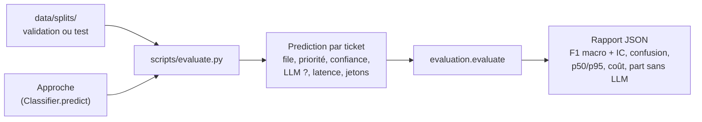

# P2-02 — Protocole d'évaluation commun

## Ce qui a été fait
- **Module `evaluation.py`**, qui note toutes les approches de la même façon :
  - F1 macro de la file et de la priorité, avec intervalle de confiance à 95 % par bootstrap (1 000 tirages, graine fixe) ;
  - exactitude, F1 par file et matrices de confusion ;
  - latence p50 / p95 par ticket ;
  - coût pour 1 000 tickets, calculé à partir des jetons LLM et du tarif public du fournisseur ;
  - part des tickets traités sans LLM.
- **Interface commune** : une approche est un `Classifier` qui renvoie une `Prediction` par ticket (file, priorité, confiance, LLM utilisé ou non, latence, jetons). Le routage hybride de P2-08 se branchera sur la même interface.
- **Script `scripts/evaluate.py <approche> --partie validation|test`** : il charge la partie demandée du découpage figé, fait prédire l'approche et écrit le rapport (`eval/results/<approche>-<partie>.json`) et les prédictions ticket par ticket.
- **Référence triviale « majorité »** : elle prédit toujours la file et la priorité les plus fréquentes de l'entraînement. Elle valide la chaîne et fixe le plancher à battre.
- **8 tests** dont les valeurs attendues sont calculées à la main (F1, classe jamais prédite, bootstrap reproductible, matrice, percentiles, coût, prédictions manquantes).

## Résultat mesuré (référence « majorité »)
| | Validation | Test |
|---|---|---|
| Exactitude file | 29,3 % | 29,3 % |
| F1 macro file | 0,045 (IC 0,044–0,047) | 0,045 (IC 0,044–0,047) |
| F1 macro priorité | 0,194 (IC 0,189–0,199) | 0,195 (IC 0,190–0,200) |

Une exactitude de 29 % sans aucune intelligence, mais un F1 macro de 0,045 : c'est la démonstration chiffrée qu'il faut juger le routage au F1 macro.

## Pourquoi ce choix plutôt que l'alternative courante
- **Des métriques écrites à la main plutôt que `sklearn.metrics`** : elles tiennent en quelques lignes, chaque formule est testée sur un exemple calculé à la main, et le module n'ajoute aucune dépendance. scikit-learn arrivera en P2-03 pour l'entraînement, pas pour la notation.
- **Un intervalle par bootstrap plutôt qu'un chiffre seul** : avec 4 287 tickets de test et des files à 60 tickets, un écart de 0,01 entre deux approches peut n'être que du bruit. L'intervalle dit si une différence est interprétable.
- **Un seul script et une seule interface pour toutes les approches** : même partie du découpage, mêmes métriques, même format de sortie. La comparaison finale ne dépendra pas d'un détail de code propre à une approche.
- **Le coût ne compte que les jetons LLM** : le calcul CPU des modèles légers est négligeable devant un appel au LLM, et le rapport le dira explicitement plutôt que d'inventer un prix d'infrastructure.

## Schéma

## 5 questions d'entretien
1. **Pourquoi le F1 macro, et que montre la référence « majorité » ?**
   Le F1 macro est la moyenne des F1 de chaque file : chaque file compte autant, même rare. Prédire toujours « Technical Support » donne 29,3 % d'exactitude mais 0,045 de F1 macro, car les 9 autres files ont un F1 nul. L'exactitude récompense un modèle paresseux ; le F1 macro le démasque.
2. **Comment calcules-tu l'intervalle de confiance du F1 macro ?**
   Par bootstrap : je tire 1 000 fois, avec remise, autant de tickets que dans le jeu, je recalcule le F1 macro à chaque tirage et je prends les percentiles 2,5 et 97,5. Le F1 macro n'a pas de formule simple d'intervalle, contrairement à une proportion, d'où cette méthode. La graine est fixe pour que le rapport soit reproductible.
3. **Pourquoi ne pas utiliser scikit-learn pour les métriques ?**
   Elles tiennent en quelques lignes et je peux les expliquer et les tester sur des exemples calculés à la main. Ce qui compte, c'est que toutes les approches soient notées par le même code. scikit-learn sera utilisé pour entraîner les modèles, où il apporte vraiment quelque chose.
4. **Comment le coût pour 1 000 tickets est-il calculé ?**
   Je fais la moyenne des jetons d'entrée et de sortie par ticket, je multiplie par le tarif public du fournisseur par million de jetons, puis par 1 000. Les modèles légers ne consomment pas de jetons : leur coût CPU est négligé, et je le dis dans le rapport. Pour le routage hybride, le coût baisse en proportion des tickets qui n'appellent pas le LLM.
5. **Que se passe-t-il si une approche oublie un ticket ou invente une file ?**
   Un ticket sans prédiction fait échouer l'évaluation, plutôt que de calculer un score sur un sous-ensemble flatteur. Une file inventée, par exemple par un LLM, compte comme une erreur : elle apparaît dans la matrice de confusion et fait baisser le F1 de la vraie file.
