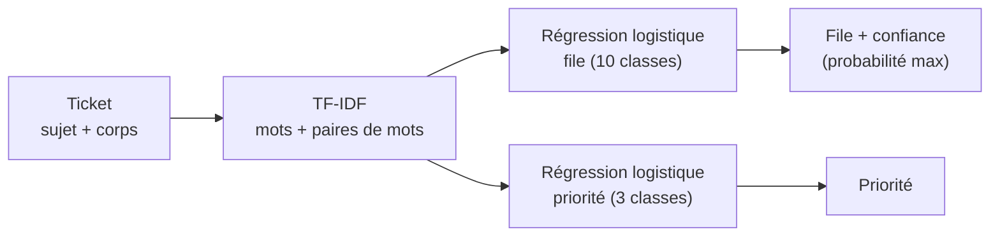

# P2-03 — Base TF-IDF + régression logistique

## Ce qui a été fait
- **`tfidf.py`** : deux modèles TF-IDF + régression logistique, un pour la file et un pour la priorité.
  - Le TF-IDF prend les mots et les paires de mots qui apparaissent dans au moins deux tickets, avec une fréquence amortie (`sublinear_tf`).
  - La probabilité de la file prédite sert de **confiance** : c'est elle que le routage hybride comparera au seuil (P2-08).
- **Réglage sur la validation uniquement** (`scripts/tune_tfidf.py`) : grille sur la régularisation C (1 à 256) et la pondération des classes. Retenu : **C = 64, classes pondérées** (critère 0,619, moyenne des deux F1 macro). Au-delà, le score redescend (0,614 à C = 256).
- **Mesure unique sur le test**, après le choix du réglage, avec `scripts/evaluate.py tfidf --partie test`.

## Résultats mesurés
| | Majorité (test) | TF-IDF, validation | **TF-IDF, test** |
|---|---|---|---|
| F1 macro file | 0,045 | 0,609 (IC 0,585–0,628) | **0,588 (IC 0,565–0,606)** |
| F1 macro priorité | 0,195 | 0,629 (IC 0,613–0,643) | **0,615 (IC 0,600–0,629)** |
| Exactitude file | 29,3 % | 61,4 % | **60,4 %** |
| Latence p50 / p95 par ticket | — | — | **1,6 ms / 2,5 ms** (CPU) |
| Coût pour 1 000 tickets | 0 | 0 | **0** (aucun appel LLM ; CPU négligé) |

- **F1 par file (test)** : de 0,795 (Billing and Payments) à 0,496 (Returns and Exchanges).
- **Confusions principales** : Product Support et Technical Support (174 et 143 tickets dans chaque sens), puis IT Support classé en Technical Support (128). Ce sont des files proches par leur vocabulaire.
- **Test un peu sous la validation** (0,588 contre 0,609), ce qui est attendu : le réglage a été choisi sur la validation.

## Pourquoi ce choix plutôt que l'alternative courante
- **Commencer par une base simple plutôt que directement par un LLM** : sans référence chiffrée, on ne sait pas ce qu'apporte le LLM ni ce qu'il coûte. TF-IDF s'entraîne en moins d'une minute sur CPU, répond en 2 ms et ne coûte rien par ticket. C'est la référence que le LLM et les embeddings doivent battre.
- **Classes pondérées** : sans pondération, le modèle néglige les files rares. Avec C = 64, la pondération fait passer le F1 macro de la file de 0,583 à 0,609 sur la validation.
- **Réglage sur la validation, test lu une seule fois** : si l'on choisissait C en regardant le test, le score publié serait optimiste. La légère baisse entre validation et test en est l'illustration.
- **Grille élargie quand le meilleur réglage tombe au bord** : C = 16 était le maximum de la première grille et le score montait encore. On a donc étendu la grille jusqu'à trouver un sommet, plutôt que de s'arrêter au bord.

## Schéma

## 5 questions d'entretien
1. **Que vaut TF-IDF ici, et comment le sais-tu ?**
   Sur le test, il obtient un F1 macro de 0,588 pour la file (IC 0,565–0,606) et de 0,615 pour la priorité, contre 0,045 et 0,195 pour la référence « majorité ». Le réglage a été choisi sur la validation, et le test n'a été lu qu'une fois, d'où un score légèrement inférieur à celui de la validation.
2. **À quoi sert la pondération des classes ?**
   Les files vont de 29 % à 1,4 % des tickets. Sans pondération, se tromper sur une file rare coûte peu à l'apprentissage, et le modèle la néglige. « balanced » pondère chaque ticket à l'inverse de la fréquence de sa file. Le F1 macro, qui donne le même poids à chaque file, gagne alors environ 2,5 points sur la validation.
3. **Que représente C, et pourquoi 64 ?**
   C est l'inverse de la régularisation : plus il est grand, plus le modèle colle aux données d'entraînement. J'ai testé de 1 à 256 sur la validation : le score monte jusqu'à 64 puis redescend, signe que le modèle commence à trop coller à l'entraînement. Une valeur aussi grande s'explique par le vocabulaire très large (mots et paires de mots), où chaque poids reste petit.
4. **Où le modèle se trompe-t-il, et est-ce grave ?**
   Surtout entre Product Support et Technical Support, et entre IT Support et Technical Support : ce sont des files au vocabulaire proche. Pour un service desk, c'est un risque de réaffectation entre deux équipes techniques voisines. C'est exactement là que la confiance du modèle devrait être basse et qu'un appel au LLM peut aider. C'est l'hypothèse que testera le routage hybride.
5. **Pourquoi garder TF-IDF si un LLM fait mieux ?**
   Parce qu'il répond en 2 ms, gratuitement et sans dépendre d'un fournisseur externe. Si l'on n'appelle le LLM que pour les tickets où TF-IDF doute, on garde presque toute la qualité du LLM pour une fraction de son coût. C'est l'objet du projet, et ce sera mesuré en P2-08.
