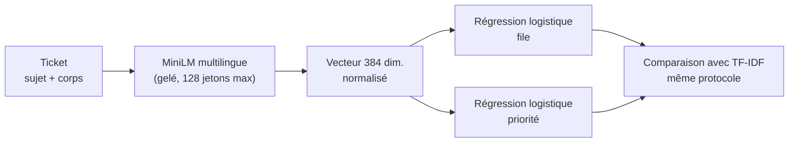

# P2-04 — Embeddings multilingues + classifieur

## Ce qui a été fait
- **`embeddings.py`** : un modèle d'embeddings multilingue gelé (fastembed, local, sans clé), puis deux régressions logistiques sur les vecteurs normalisés, une pour la file et une pour la priorité. L'interface `Embedder` permet de tester la chaîne sans télécharger de modèle.
- **Trois modèles légers examinés**, tous proposés par fastembed et sous licence libre :
  - `paraphrase-multilingual-mpnet-base-v2` (768 dimensions) : écarté avant le réglage, car il met environ 0,36 s par ticket (178 s pour 500 tickets), soit plus de 2 h pour vectoriser le jeu ;
  - `paraphrase-multilingual-MiniLM-L12-v2` (384 dimensions) ;
  - `potion-multilingual-128M` (256 dimensions, modèle statique, environ 2 ms par ticket).
- **Cache des vecteurs** (`scripts/embed_splits.py`, dans `data/processed/`, non versionné) : MiniLM a mis 1 108 s pour les 19 998 tickets d'entraînement. Le réglage relit ce cache au lieu de tout recalculer.
- **Réglage sur la validation uniquement** (`scripts/tune_embeddings.py`) : grille sur le modèle, C (de 1 à 1024) et la pondération des classes, avec le même critère que TF-IDF. Retenu : **MiniLM, C = 256, sans pondération** (critère 0,393). La grille a été étendue à 1024, car le meilleur réglage tombait au bord ; le score y redescend (0,390).
- **Mesure unique sur le test** avec `scripts/evaluate.py embeddings --partie test`.

## Résultats mesurés
| | TF-IDF (test) | Potion, validation | MiniLM, validation | **MiniLM, test** |
|---|---|---|---|---|
| F1 macro file | **0,588** (IC 0,565–0,606) | 0,319 | 0,354 (IC 0,333–0,376) | 0,344 (IC 0,322–0,363) |
| F1 macro priorité | **0,615** (IC 0,600–0,629) | 0,393 | 0,432 (IC 0,417–0,445) | 0,419 (IC 0,403–0,432) |
| Exactitude file | **60,4 %** | — | 43,1 % | 41,3 % |
| Latence p50 / p95 par ticket | **1,6 / 2,5 ms** | — | — | 22 / 31 ms (CPU) |

- **Les embeddings perdent nettement face à TF-IDF**, sur toutes les files, et les intervalles ne se chevauchent pas. Le meilleur F1 par file est 0,670 (Billing and Payments, contre 0,795 pour TF-IDF) et le plus faible 0,173 (General Inquiry, contre 0,527).
- **Confusions** : beaucoup de tickets partent vers Technical Support, la file la plus fréquente : 355 tickets de Product Support, 272 d'IT Support et 237 de Customer Service.
- **Troncature** : MiniLM lit au plus 128 jetons. Sur le test, la médiane est de 90 jetons et 18,5 % des tickets dépassent cette limite. La troncature n'explique donc qu'une petite partie de l'écart.

## Choix du modèle léger
**TF-IDF reste le modèle léger du routage hybride (P2-08)** : il est meilleur (0,588 contre 0,344), environ 12 fois plus rapide au p95 (2,5 ms contre 31 ms) et n'ajoute aucun modèle de 220 Mo à l'image Docker. Les embeddings ne sont pas retenus pour la classification.

## Pourquoi ce choix plutôt que l'alternative courante
- **Mesurer plutôt que supposer que « les embeddings, c'est mieux »** : c'est souvent vrai pour la recherche sémantique, mais pas ici. Hypothèse, non démontrée : les embeddings gelés résument le sens général du ticket, alors que les files de ce jeu, probablement synthétique, se distinguent par des mots précis, que TF-IDF apprend directement à partir de 20 000 exemples.
- **fastembed (ONNX) plutôt que sentence-transformers (PyTorch)** : même modèle, sans installer PyTorch. C'est déjà le choix de P1, et l'image reste légère.
- **Modèle gelé plutôt qu'affiné (fine-tuning)** : un affinage demande un GPU ou des heures de CPU, ce qui dépasse le cadre d'un ticket. Le LLM few-shot (P2-05) est l'alternative « sémantique » prévue dans le protocole.
- **Écarter mpnet sur une mesure de vitesse** : à 0,36 s par ticket, il serait trop lent pour la démo et pour vectoriser le jeu dans une session. Sa qualité n'a donc pas été mesurée, et ce document ne prétend pas le contraire.

## Schéma

## 5 questions d'entretien
1. **Pourquoi les embeddings font-ils moins bien que TF-IDF ici ?**
   C'est mesuré : 0,344 contre 0,588 de F1 macro sur la file au test, avec des intervalles disjoints. Mon hypothèse est que le modèle gelé résume le sens général d'un texte, alors que les files se séparent sur des mots précis qu'une régression sur TF-IDF apprend directement. La troncature à 128 jetons ne touche que 18,5 % des tickets, donc elle n'explique pas tout. Je ne l'ai pas démontré : il faudrait un affinage ou une analyse plus fine pour le confirmer.
2. **Comment as-tu choisi entre les modèles d'embeddings ?**
   Sur la validation, avec le même critère que TF-IDF, la moyenne des F1 macro de la file et de la priorité. MiniLM obtient 0,393 et potion 0,356. J'ai écarté mpnet avant même de le régler, parce qu'il prenait 0,36 s par ticket : trop lent pour l'usage visé. Je le dis comme un choix de coût, pas comme un résultat de qualité.
3. **Pourquoi ne pas affiner le modèle d'embeddings ?**
   Parce que cela demande un GPU ou des heures de CPU et sort du cadre du ticket. L'approche sémantique forte du protocole, c'est le LLM few-shot de P2-05. Si le projet devait aller plus loin, j'essaierais un affinage de type SetFit et je le mesurerais avec le même protocole.
4. **Pourquoi la pondération des classes n'est-elle pas retenue, alors qu'elle l'était pour TF-IDF ?**
   Parce que le critère est la moyenne des deux F1 macro. Pour MiniLM, la pondération améliore la priorité (0,449 contre 0,432) mais fait perdre plus sur la file (0,295 contre 0,354). Le critère était fixé à l'avance, donc je l'applique, même si le résultat diffère de celui de TF-IDF.
5. **Ce ticket a-t-il servi à quelque chose, puisque l'approche est écartée ?**
   Oui : il justifie, chiffres à l'appui, le choix de TF-IDF comme modèle léger du routage hybride, au lieu d'un choix fait par habitude. Il montre aussi le coût réel : 22 ms par ticket et un modèle de 220 Mo, pour un résultat moins bon.
